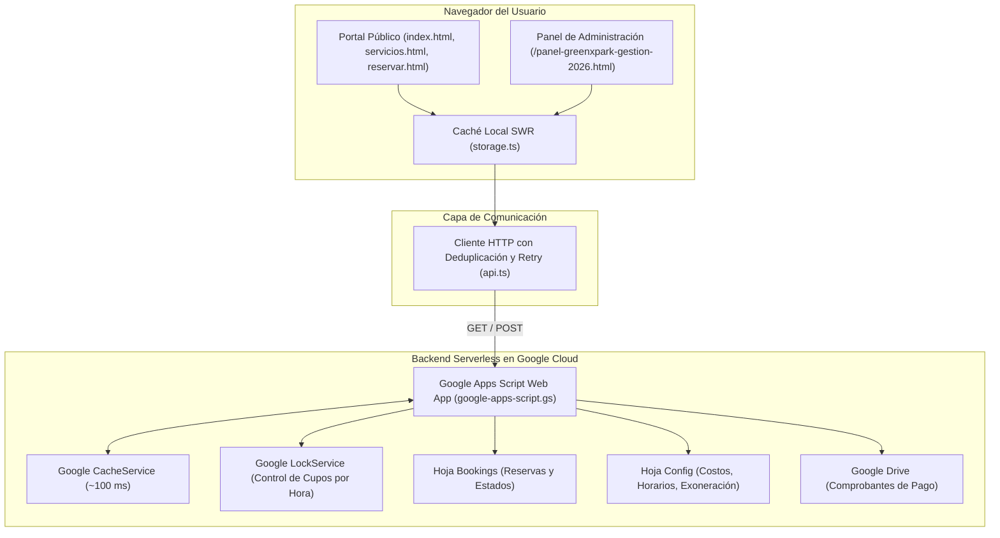

# GREEN X PARK — Extreme Sports | Plataforma Oficial de Reservas

Plataforma web integral de **GREEN X PARK — EXTREME SPORTS**, centro recreativo de motocross y enduro para niños, jóvenes y adultos. Permite agendar en línea alquiler de Pit Bikes con inducción incluida, práctica libre en moto propia y alquiler exclusivo de escenario para eventos privados, respaldada por un backend **serverless** en Google Workspace (**Google Sheets**, **Google Apps Script** con `CacheService`/`LockService` y **Google Drive**) y desplegada en **GitHub Pages**.

---

## Tabla de contenidos

- [Visión general](#visión-general)
- [Funcionalidades principales](#funcionalidades-principales)
- [Arquitectura del sistema](#arquitectura-del-sistema)
- [Tecnologías utilizadas](#tecnologías-utilizadas)
- [Estructura del proyecto](#estructura-del-proyecto)
- [Rutas y páginas](#rutas-y-páginas)
- [Manual de marca](#manual-de-marca)
- [Instalación y comandos](#instalación-y-comandos)

---

## Visión general

**GREEN X PARK** acerca el motocross a todas las personas, convirtiéndolo en una experiencia recreativa, familiar y accesible sin necesidad de contar con motocicleta propia ni experiencia previa:

1. **Vive la Experiencia (Alquiler de Pit Bikes)**: Paquetes de **10, 15, 20 y 30 minutos** de conducción con **inducción inicial de 10 minutos incluida** y orientación en pista.
2. **Práctica Libre (Derecho a Pista)**: Acceso de día completo para pilotos con motocicleta propia en dos escenarios: **Pista de Motocross (MX)** y **Pista de Enduro**.
3. **Eventos Privados y Alquiler de Escenario**: Reserva de escenario para activaciones de marca, eventos corporativos, lanzamientos comerciales y grupos privados (tarifas diferenciadas entre semana y fines de semana/festivos).

---

## Funcionalidades principales

### 1. Sistema de Reservas en Línea (`reservar.html`)
- **Selección de día y bloque horario en tiempo real**: Muestra los turnos cada hora según el día elegido (Martes a Viernes de `8:00 a. m. – 5:00 p. m.` y Sábados, Domingos y Festivos de `9:00 a. m. – 6:00 p. m.`).
- **Control de cupos por hora**: Permite reservar de `1` a `N` cupos/motos disponibles en una misma hora (por defecto `5` motos por hora, configurable desde el panel administrativo) recalculando automáticamente el valor total.
- **Apartado inmediato y prevención de sobrecupo**: Al enviar el formulario con el comprobante de pago, el cupo queda apartado de inmediato (`LockService` en Google Apps Script previene colisiones concurrentes).
- **Carga de comprobante de pago a Google Drive**: Soporta imágenes (`JPG`, `PNG`, `WEBP`) y documentos `PDF` (hasta `5 MB`), subiéndolos automáticamente a la carpeta oficial de Drive con enlace directo.
- **Autorización de Tratamiento de Datos y Exoneración de Responsabilidad**: Checkbox obligatorio acompañado de un modal interactivo (`<dialog>`) donde el usuario puede leer y aceptar los términos legales (100% editables desde el Panel de Administrador).

### 2. Panel de Administración (`/panel-greenxpark-gestion-2026.html`)
- **Seguridad Serverless**: La contraseña nunca se expone en el código fuente; se valida directamente contra `PropertiesService.getScriptProperties().getProperty('ADMIN_PASSWORD')` en Google Apps Script.
- **Gestión de Reservas**:
  - Filtros por fecha, modalidad, estado (`Pendiente`, `Confirmada`, `Cancelada`) y buscador en vivo.
  - Visualización directa del comprobante de pago en Google Drive.
  - Botón directo a WhatsApp del cliente con mensaje pre-llenado.
  - Edición de reservas (reprogramación de fecha, hora, cupos y notas) y liberación automática de cupo al cancelar o eliminar.
  - Exportación instantánea a **Excel (`.xlsx`)** y **CSV (`.csv`)** con SheetJS.
- **Gestión de Costos y Tarifas**: Edición en tiempo real de paquetes de Pit Bikes, tarifa de Práctica Libre y tarifas de Eventos Privados.
- **Gestión de Horarios y Cupos**: Configuración de cupos máximos por hora, bloques horarios, festivos y bloqueo individual de fechas u horas específicas.
- **Gestión de Medios de Pago y Textos Legales**: Edición de números de Nequi, DaviPlata, WhatsApp de soporte y del texto completo del modal de Tratamiento de Datos Personales y Exoneración de Responsabilidad.

---

## Arquitectura del sistema



---

## Tecnologías utilizadas

| Área | Herramientas / Librerías |
|---|---|
| **Lenguaje y Tipado** | TypeScript 5.8, ES2022 |
| **Empaquetador y Build** | Vite 6 |
| **Diseño y Estilos** | Tailwind CSS 3 + CSS personalizado de alto octanaje |
| **Notificaciones y Modales** | `<dialog>` nativo HTML + SweetAlert2 |
| **Exportación de Datos** | SheetJS (`xlsx`) para reportes en Excel y CSV |
| **Backend Serverless** | Google Apps Script (V8) con `CacheService` y `LockService` |
| **Base de Datos y Archivos** | Google Sheets (`Bookings`, `Config`) + Google Drive (`DriveApp`) |
| **Despliegue** | GitHub Pages vía GitHub Actions (`.github/workflows/deploy.yml`) |

---

## Estructura del proyecto

```
Green X Park/
├── .github/workflows/deploy.yml           # Despliegue automático a GitHub Pages
├── docs/
│   ├── google-apps-script.gs              # Backend serverless en Google Apps Script
│   └── SETUP-GOOGLE-SHEETS.md             # Guía de configuración de Sheets, Drive y Apps Script
├── public/
│   ├── logo-green-x-park.jpeg             # Logo oficial GREEN X PARK
│   └── paleta-cromatica.jpeg              # Referencia de paleta cromática
├── src/
│   ├── config.ts                          # URL de Web App (apiUrl) y Google Sheet
│   ├── main.ts                            # Entrada de Inicio
│   ├── servicios-main.ts                  # Entrada de Servicios y Tarifas
│   ├── reservar-main.ts                   # Entrada de Reserva en Línea
│   ├── admin-main.ts                      # Entrada del Panel de Administración
│   ├── components/
│   │   ├── navbar.ts                      # Barra de navegación y telemetría superior
│   │   └── footer.ts                      # Pie de página y botón flotante de WhatsApp
│   ├── content/
│   │   └── default-config.ts              # Tarifas, horarios y textos legales por defecto
│   ├── pages/
│   │   ├── home.ts                        # Vista de Inicio y Nuestra Historia
│   │   ├── servicios.ts                   # Vista detallada de Experiencias y Tarifas
│   │   ├── reservar.ts                    # Sistema interactivo de agendamiento por hora
│   │   └── admin.ts                       # Panel administrativo de 4 módulos
│   ├── styles/
│   │   └── main.css                       # Tokens de diseño, tipografías y estilos X-Sports
│   ├── types/
│   │   └── index.ts                       # Definiciones de tipos TypeScript
│   └── utils/
│       ├── api.ts                         # Cliente HTTP con deduplicación
│       ├── export-bookings.ts             # Exportador Excel (.xlsx) y CSV
│       ├── format.ts                      # Formateo de moneda COP, fechas y horas
│       └── storage.ts                     # Capa SWR y cálculo de disponibilidad por turno
├── index.html
├── servicios.html
├── reservar.html
├── panel-greenxpark-gestion-2026.html
├── package.json
├── tailwind.config.js
├── tsconfig.json
└── vite.config.ts
```

---

## Rutas y páginas

| Archivo / Ruta | Propósito |
|---|---|
| `/index.html` | Inicio, Hero principal, Nuestra Historia, resumen de servicios, horarios y medios de pago |
| `/servicios.html` | Detalle de Vive la Experiencia (Pit Bikes), Práctica Libre (MX/Enduro) y Eventos Privados |
| `/reservar.html` | Agendamiento en línea por fecha y hora, carga de comprobante y aceptación de exoneración |
| `/panel-greenxpark-gestion-2026.html` | Panel privado de administración (reservas, costos, horarios/cupos y textos legales) |

---

## Manual de marca

| Token de Color / Tipografía | Valor | Uso |
|---|---|---|
| **1. Electric Lime (Principal)** | `#B6FF00` (`rgb(182, 255, 0)`) | Botones principales, acentos de velocidad, precios e indicadores activos |
| **2. Racing Green** | `#8FCC00` (`rgb(143, 204, 0)`) | Degradados de acción y bordes secundarios |
| **3. Neon Light** | `#D4FF66` (`rgb(212, 255, 102)`) | Estados hover, subtítulos destacados y badges |
| **4. Carbon Black** | `#0B0B0B` (`rgb(11, 11, 11)`) | Fondo principal y estructura base |
| **5. Graphite** | `#252525` (`rgb(37, 37, 37)`) | Superficies de tarjetas, contenedores y modales |
| **6. Pure White** | `#FFFFFF` (`rgb(255, 255, 255)`) | Textos principales y titulares de alto contraste |
| **Tipografía de Títulos** | `Exo 2` – ExtraBold 800 | Encabezados principales, precios y llamados a la acción |
| **Tipografía de Subtítulos** | `Montserrat` – SemiBold 600 | Subtítulos, etiquetas, navegación y badges |
| **Tipografía de Textos** | `Inter` – Regular 400 | Párrafos, descripciones, tablas y textos legales |

---

## Instalación y comandos

```bash
# 1. Instalar dependencias
npm install

# 2. Iniciar servidor de desarrollo (http://localhost:5173)
npm run dev

# 3. Compilar para producción (genera carpeta dist/)
npm run build

# 4. Previsualizar compilación de producción
npm run preview
```
